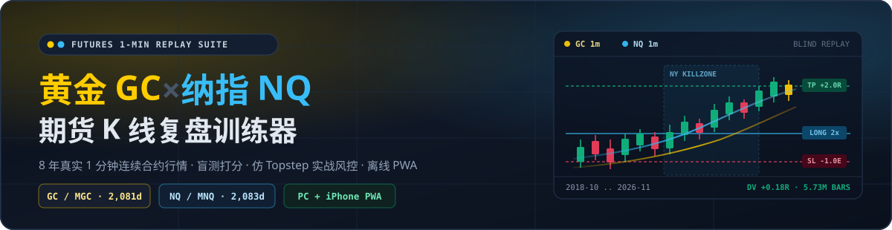
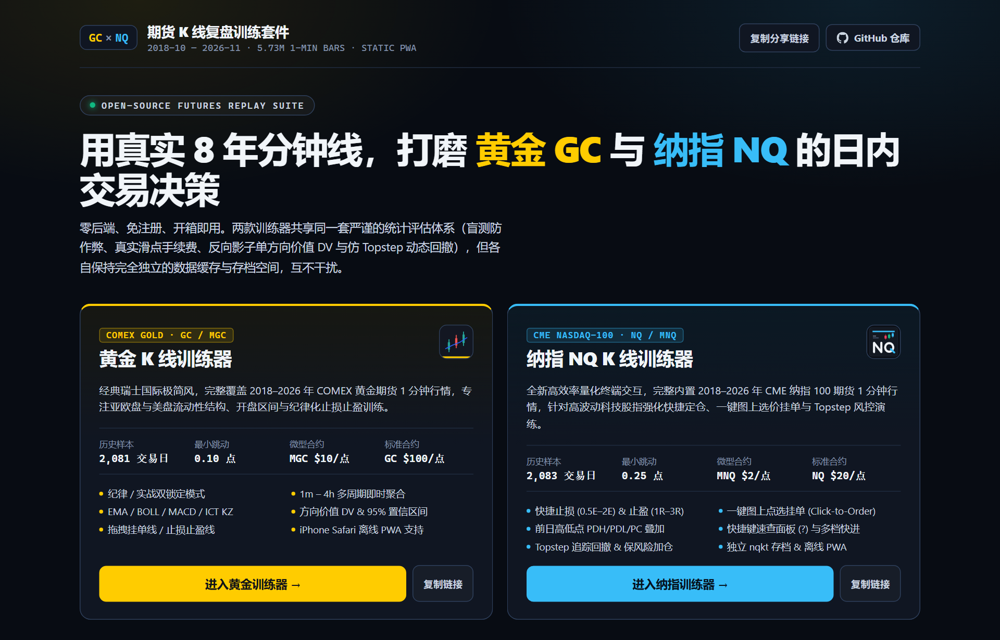
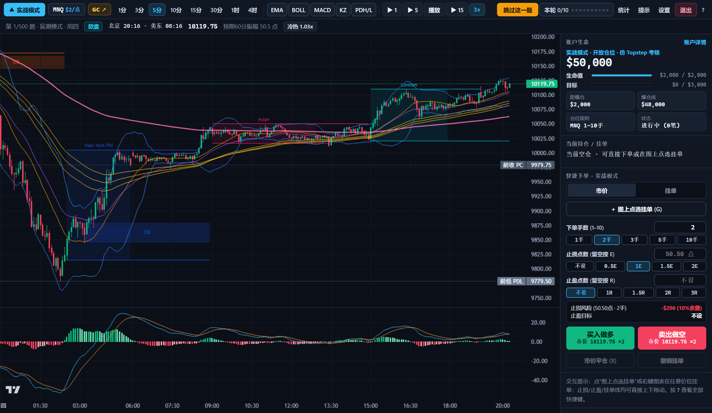
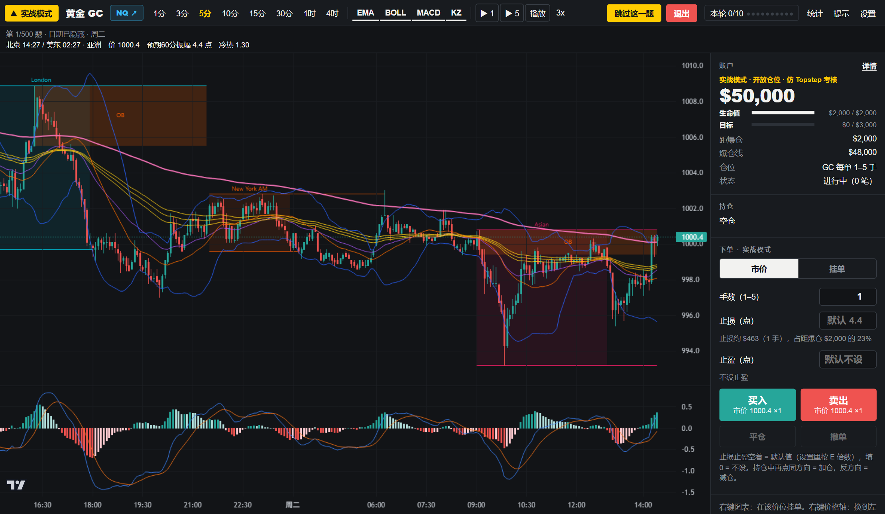

  

-10b981?style=flat-square)

-2563eb?style=flat-square)

**用 8 年真实 1 分钟期货行情做盲测刷题：练盘感、练风控、用统计学检验你的方向判断到底有没有正期望。**

---

## 一键在线体验与分享入口

无需注册、无需安装任何软件，点击下方任意入口即可在电脑或手机浏览器中直接开始训练（两款训练器页面顶部也支持一键互切）：

| 训练器版本 | 适用标的与合约 | 在线直达 / 分享链接 | 独立存档空间 |
| :--- | :--- | :--- | :---: |
| **黄金 K 线训练器**（瑞士极简风） | COMEX 黄金 `GC` / `MGC`（2,081 交易日） | **[打开黄金版 →](https://truckitty.github.io/gold-trainer/)** | `kt_*` |
| **纳指 K 线训练器**（量化终端交互） | CME 纳指 100 `NQ` / `MNQ`（2,083 交易日） | **[打开纳指版 →](https://truckitty.github.io/gold-trainer/nq/)** | `nqkt_*` |
| **双品种总览分享门户** | 同时展示 GC & NQ，适合转发给朋友 | **[打开总览页 →](https://truckitty.github.io/gold-trainer/hub.html)** | — |

> **兼容提示**：原黄金训练器地址保持根目录不变，既有用户的 iPhone 主屏幕图标与本地练习存档完全保留；纳指训练器部署在独立的 `/nq/` 路径下并采用完全隔离的 `nqkt_*` 缓存与存储空间，两款 App 可同时添加到 iPhone 主屏幕，互不干扰。

---

## 界面实拍预览

### 双品种分享门户（`hub.html`）

  

### 纳指 NQ 训练器 vs 黄金 GC 训练器（真实 1 分钟盘面回放）
<table>
  <tr>
    <td width="50%" align="center">
      <b>纳指 NQ 训练器（/nq/）</b> 
      Obsidian 量化终端风 · 快捷止损止盈 · 一键图上选价挂单 · PDH/PDL  
      
    </td>
    <td width="50%" align="center">
      <b>黄金 GC 训练器（/）</b> 
      Swiss 国际极简风 · 亚欧美三时段权重抽题 · ICT Killzones  
      
    </td>
  </tr>
</table>

---

## 核心特性与双品种规格对比

| 维度 | 黄金训练器（GC / MGC） | 纳指训练器（NQ / MNQ） |
| :--- | :--- | :--- |
| **底层数据** | COMEX 黄金连续合约 `2018-10` – `2026-11`（287 万根 1m） | CME 纳指 100 连续合约 `2018-10` – `2026-11`（286 万根 1m） |
| **跳动与合约乘数** | 最小跳动 `0.1` 点 · `MGC $10/点` / `GC $100/点` | 最小跳动 `0.25` 点 · `MNQ $2/点` / `NQ $20/点` |
| **多周期与指标** | `1m / 3m / 5m / 10m / 15m / 30m / 1h / 4h` · EMA 30/60/70/80/200 · BOLL · MACD · ICT Killzones + OB + FVG | 全套同款指标 + **前日高低点与昨收 (`PDH / PDL / PC`) 叠加线** |
| **交易交互体验** | 拖拽挂单/止损/止盈线、右键/长按图上挂单、一键保本与快进平仓 | 在上述基础上新增 **快捷 SL (`0.5E–2E`) / TP (`1R–3R`) 按钮**、**图上点选挂单模式**、**`?` 快捷键速查面板**与多档快进 |
| **双锁定考核模式** | **纪律模式**（固定仓位） & **实战模式**（仿 Topstep 动态追踪回撤、加减仓、保风险加仓、实时爆仓价线） | 同上，默认采用微型 `MNQ` 精细控风，设置中可一键切换标准 `NQ` |
| **盲测与统计学评估** | 隐藏真实日期 + 价格线性平移防作弊；每笔交易自动生成**反向影子单**，实时输出**方向价值（Direction Value）**、95% 置信区间、t 统计量与跳过反事实统计 | 同上，并内置 A/B Killzones 对照实验模式与多存档槽位（升级不丢记录） |
| **宏观高危日过滤** | 内置 2018–2026 完整 **FOMC / 非农（NFP）/ CPI** 日历，默认排除新闻日聚焦常规微观结构 | 同上，设置中可随时切换包含或仅练宏观事件日 |

---

## 手机端（iPhone Safari）离线安装指南

1. 用 iPhone **Safari** 打开想安装的训练器地址：
   - 黄金版：`https://truckitty.github.io/gold-trainer/`
   - 纳指版：`https://truckitty.github.io/gold-trainer/nq/`
2. 点击底部工具栏 **「分享」** 图标 → 选择 **「添加到主屏幕」**。
3. 从桌面图标首次打开时，页面会在后台自动缓存全部年度数据包（每个品种约 12–13 MB gzip 压缩传输，建议在 Wi-Fi 下完成）；缓存就绪后，**飞行模式或无网络环境下同样可完整刷题**。
4. 练习记录保存在本机浏览器中，建议定期在 **「设置 → 数据」** 中导出 JSON / CSV 备份。

---

## 电脑端快捷键速查

| 按键 | 功能 | 按键 | 功能 |
| :---: | :--- | :---: | :--- |
| `→` / `Shift + →` | 前进 1 根 / 5 根 K 线 | `B` / `S` | 市价买入 / 卖出 |
| `↓` | 前进 15 根 K 线（NQ 版） | `X` | 平仓 / 撤挂单 |
| `P` / `Space` | 自动播放 / 暂停 | `N` | 跳过本题 / 下一题 |
| `1` – `8` | 切换周期（1分 至 4小时） | `?` | 打开快捷键速查弹窗（NQ 版） |

---

## 开源许可与致谢

- **声明**：本项目仅用于个人交易复盘与风控纪律训练，**不构成任何投资建议**。
- **图表引擎**：[TradingView Lightweight Charts™](https://github.com/tradingview/lightweight-charts)（Apache License 2.0，详见 `lib/` 目录）。
- **Killzones 叠加模块**：移植自 LuxAlgo 的 *"ICT Killzones Toolkit"*，遵循 [CC BY-NC-SA 4.0](https://creativecommons.org/licenses/by-nc-sa/4.0/) 协议，**仅限非商业用途**。
